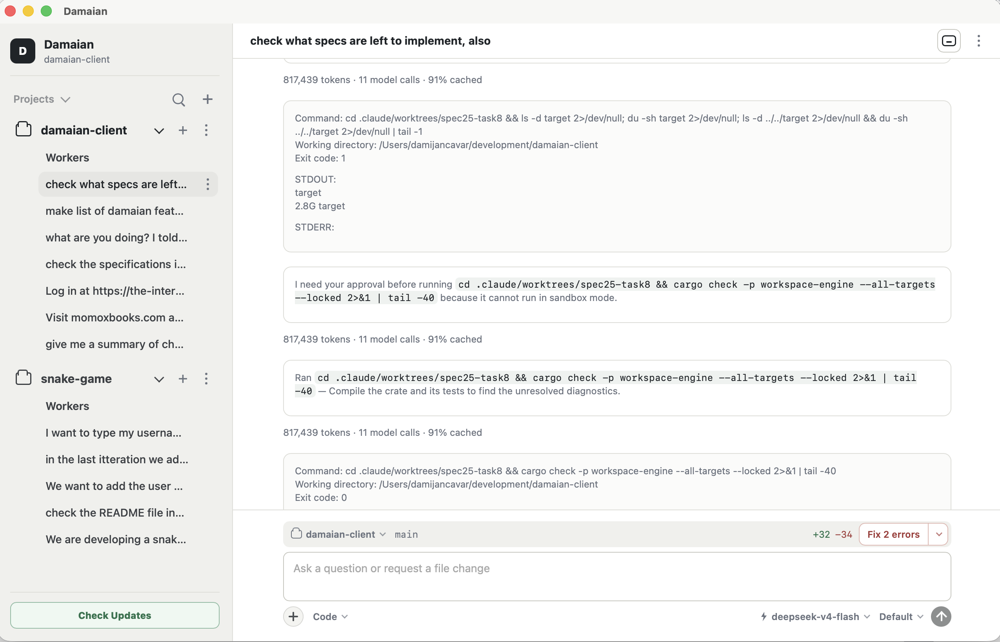

# Damaian

A local-first AI coding assistant for macOS. Damaian works on a Git repository
on your machine: it answers questions about your code, previews every edit as a
diff before touching a file, and keeps file access, command execution, and your
API keys under your control.

> **Developer preview.** Damaian is signed, notarized, and usable for everyday
> local work, and it updates itself from GitHub Releases. It is still a preview:
> the feature set is moving, and configuration and stored data may change shape
> between releases.

## What you can do

### Understand your code

- **Ask about your repository.** Streamed answers list the files they read;
  `AGENTS.md` files, nested ones included, act as scoped project rules.
- **Work across a monorepo.** Each project is a *root* whose commands run in its
  own directory; adjust roots in **Settings › General**.
- **See what a web page does.** With a browser MCP server, the assistant reports
  a page's errors, console problems and failed requests. Remote pages ask first.

### Change it safely

- **Review edits before they land.** Apply a diff per file or per hunk; a file
  you changed after the preview is blocked, not overwritten.
- **Follow the plan.** Approve a multi-step plan before anything changes, then
  see each step end **Confirmed**, **Completed, unverified**, **Blocked** or
  **Skipped**, with the evidence behind it.
- **Fix what a check found.** Errors from compilers, tests, lint and the browser
  become findings: **Fix N errors** repairs them all, **Fix selected** some.

### Stay in control

- **Working modes.** **Ask**, **Plan**, **Code** or **Review** sets what the
  assistant can do in a session.
- **Permission profiles.** Pick one per repository, from **Read-only** to **Full
  repository development**. A profile only ever narrows.
- **Command approval.** Read-only commands run on their own; everything else
  shows the full command and waits for you. Docker commands always ask.
- **Long turns.** **Stop** (or `Escape`) ends a turn; one that runs out of tool
  rounds pauses on **Continue — N more** or **Answer now**.
- **Cost.** Each reply shows tokens, model calls, prompt-cache hit rate and a
  cost at your own rates; `agent_max_task_tokens` caps one turn.
- **Provider fallback.** If your provider refuses a turn, Damaian can offer a
  second configured one for that turn only, and only if you accept.
- **Secrets.** Credentials are redacted from context, command output and diffs;
  your API key stays in the macOS Keychain.

### Organize your work

- **Projects and sessions** are grouped by folder in the sidebar; search every
  session's text, or export one as secret-redacted Markdown.
- **The repo bar** above the prompt shows branch, change count and a **Fix**
  action when a check found errors.
- **Worker sessions** (opt-in) run handed-off tasks in their own Git worktree,
  tracked on each project's **Workers** board.
- **Hand-offs:** open the folder in VS Code, Finder or the built-in terminal;
  connect MCP servers; script it with the `damaian` CLI, built from source (see
  [Development](docs/DEVELOPMENT.md#cli)).
- **Updates** install in place from the sidebar after you confirm.

### Recover from mistakes

- **Rewind** any turn's file changes, conversation, or both, from its
  checkpoint. Checkpoints are session recovery, not a substitute for a commit.
- **After a crash**, the session says what was interrupted and offers
  **Resume**, **Inspect**, **Mark failed** or **Abandon**. It never re-runs an
  action whose outcome is unknown.

## Requirements

- A Mac with Apple Silicon, running macOS 14 (Sonoma) or newer
- Git installed and on your `PATH`
- An API key for a supported model provider (OpenAI, DeepSeek, OpenRouter,
  Ollama Cloud, or any OpenAI-compatible endpoint), or the Ollama app for local
  models

No Node.js runtime is required to run the packaged app.

## Install

1. Download `Damaian_<version>_aarch64.dmg` from the
   [latest release](https://github.com/damijanc/damaian/releases/latest).
2. Open the DMG and drag `Damaian.app` into `Applications`.
3. Launch it. Builds are Developer ID signed and notarized, so macOS should open
   them without a Gatekeeper prompt — see
   [macOS Installation](docs/MACOS_INSTALLATION.md) if yours does not.

## Quick start

1. Open Damaian and select `+` beside **Projects** to pick a local Git
   repository.
2. Open **Settings** (`⌘,`), add your model provider details, leave
   **Native tool-calling** on (the default), and use the **Model API Key**
   controls to store your key in the Keychain. Without native tool-calling the
   assistant can answer questions but cannot propose file changes.
3. Ask a question about the repository in the conversation, or request a change
   such as "add a test for the config parser" and review the diff preview.

The [Damaian User Guide](docs/USER_GUIDE.md) walks through each of these in
detail. To build Damaian from source, see [Development](docs/DEVELOPMENT.md).

## Documentation

- [User Guide](docs/USER_GUIDE.md) — day-to-day usage, settings, model providers
- [macOS Installation](docs/MACOS_INSTALLATION.md) — install and first-launch steps
- [Troubleshooting](docs/TROUBLESHOOTING.md) — config and log locations, diagnosing failures
- [Security Policy](SECURITY.md) — safety model and vulnerability reporting
- [Development](docs/DEVELOPMENT.md) — building from source, the CLI, and releases
- [UI Style Guide](docs/UI_STYLE_GUIDE.md) — the desktop shell's visual language, with a rendered specimen page you open from a checkout
- [Feature specs](docs/specs/README.md) — what is built, what is planned, and in what order
- [AGENTS.md](AGENTS.md) — conventions and constraints for coding agents

## License

See [LICENSE](LICENSE).
