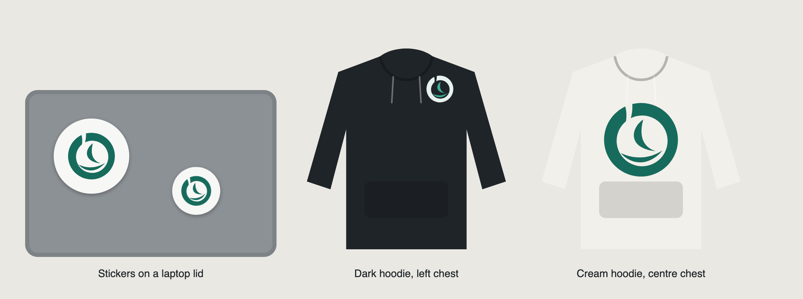

# Damaian brand mark

An abstract seed: a ring that curls into itself, holding a sprouting blade above a sweep. The ring
is the user's machine and repository, and the seed is work growing safely inside it.

## Files

| File | Use |
| --- | --- |
| `damaian-mark.svg` | Primary mark, teal on light backgrounds |
| `damaian-mark-dark.svg` | Two-tone mark for dark fabric and dark backgrounds |
| `damaian-mark-white.svg` | One-colour white, for screen print or embroidery on dark garments |
| `damaian-mark-ink.svg` | One-colour ink, for single-colour print on light garments |
| `damaian-sticker.svg` | Round die-cut sticker: cream disc with the primary mark |
| `*-3000.png` | 3000 × 3000 px transparent renders of each SVG |

The SVGs are plain filled paths with no masks, strokes or gradients, so print shops and
embroidery digitizing software can take them as they are. For a sticker, the die-cut line is the
sticker's outer circle.

## Colours

| Name | Hex | Where |
| --- | --- | --- |
| Teal | `#176b5d` | Primary mark; the app's `--accent` |
| Ink | `#1f2428` | Dark garments, one-colour print; the app's `--ink` |
| Cream | `#f7f7f5` | Sticker background; the app's `--bg` |
| Soft teal | `#e7f1ee` | Ring on dark backgrounds; the app's `--accent-soft` |
| Bright teal | `#3fae96` | Seed on dark backgrounds only: the primary teal disappears on charcoal |

## Sizes

- Keep the mark at least 25 mm wide in print and embroidery, so the curl cut and the sweep stay
  open.
- Leave clear space of at least a quarter of the mark's width on every side.
- A left-chest hoodie mark works at 50–80 mm, and a centre-chest mark at 200–250 mm.
